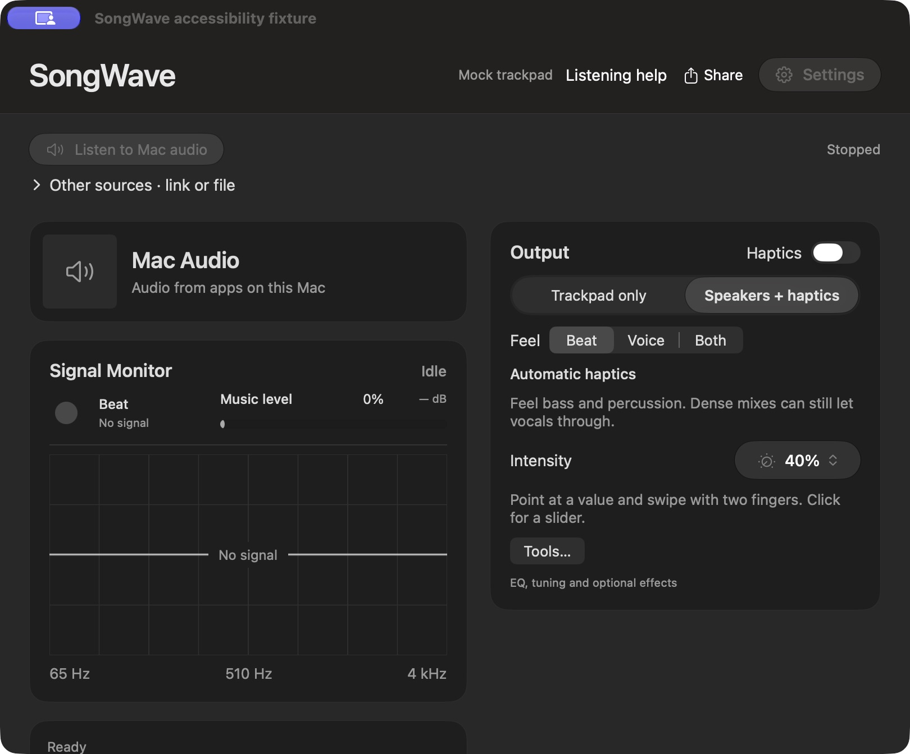
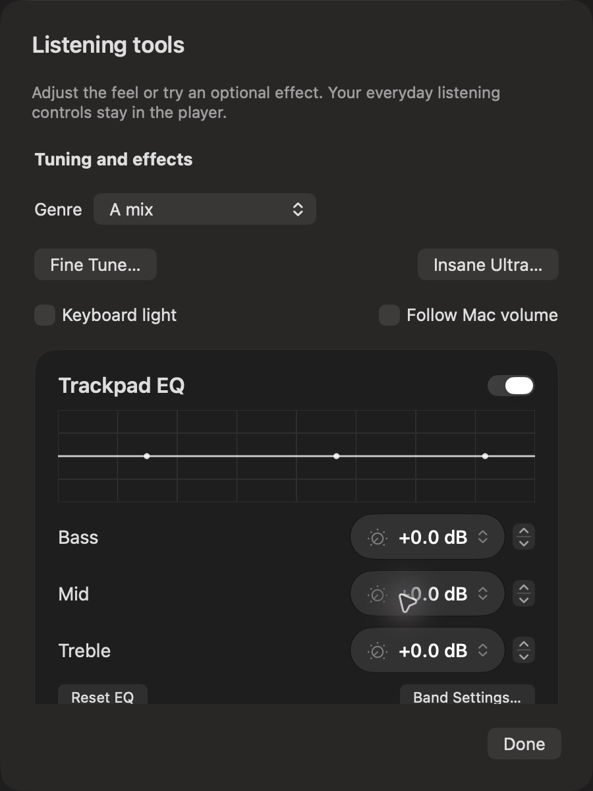
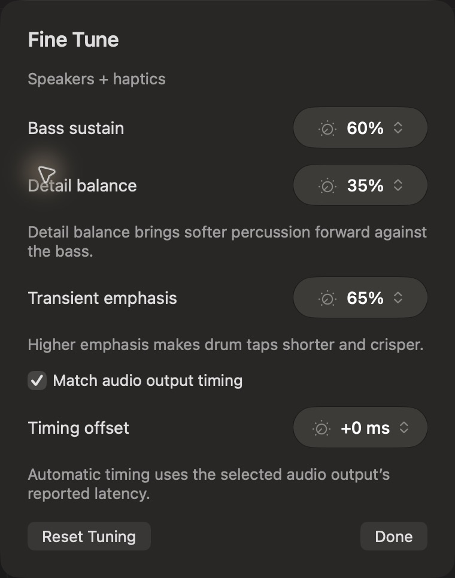
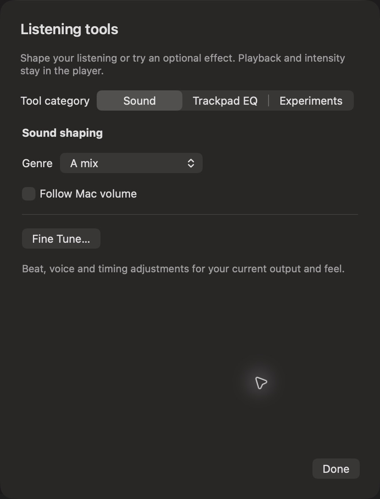
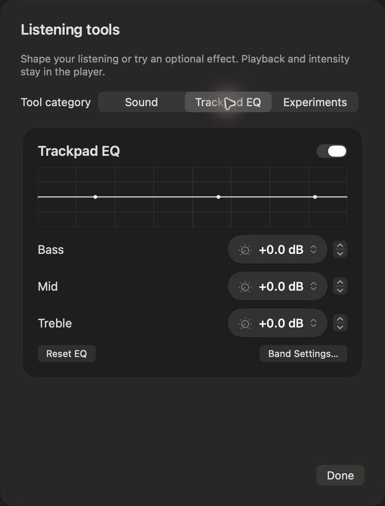
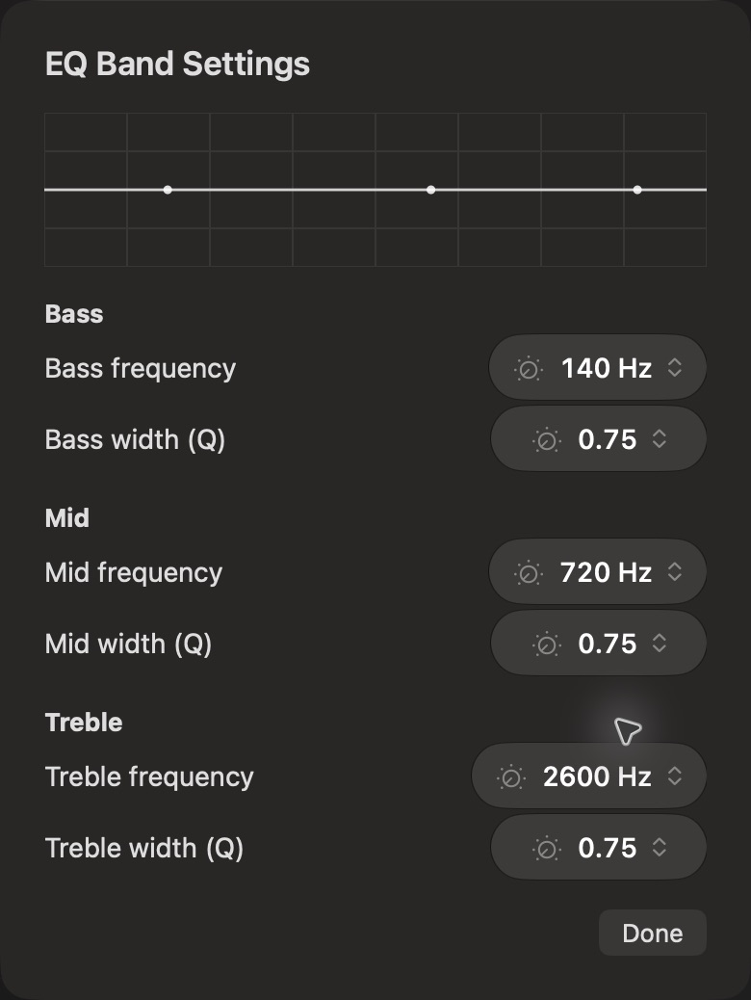
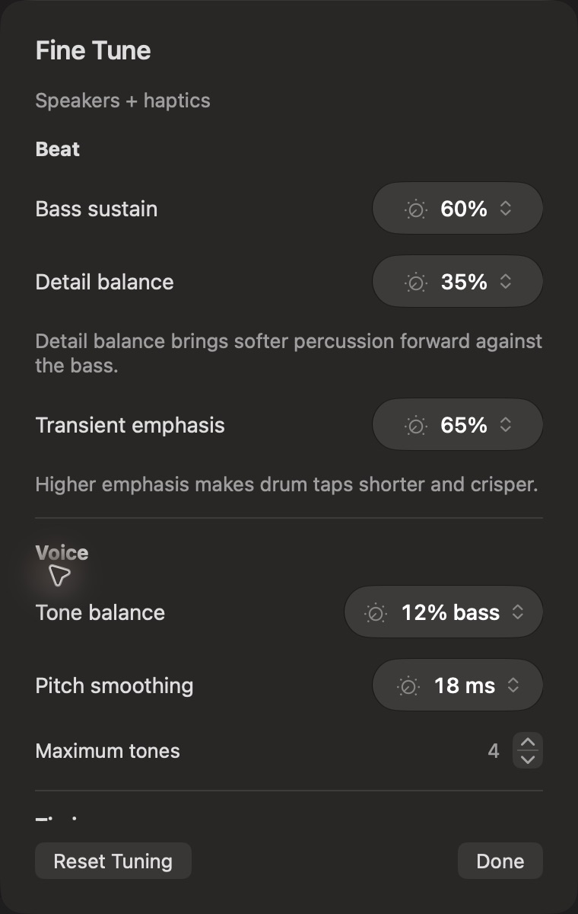
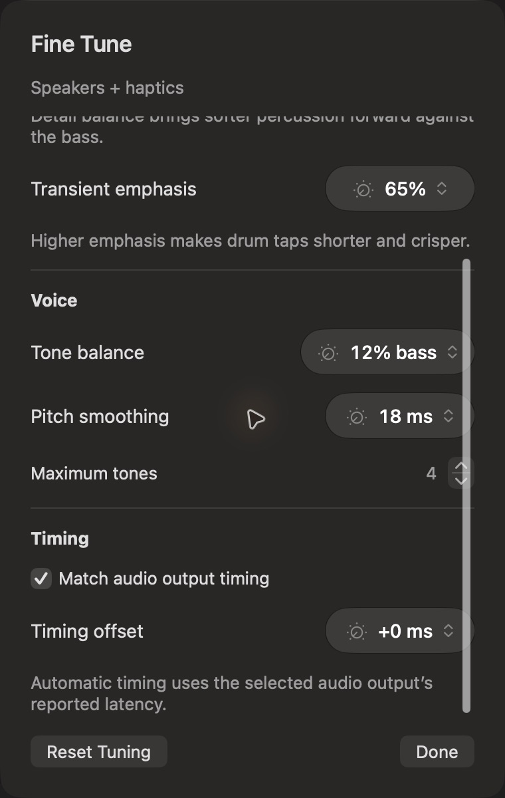
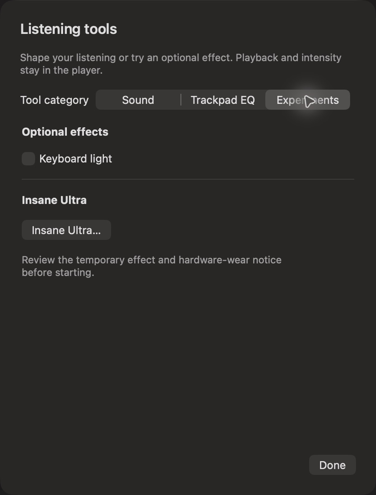
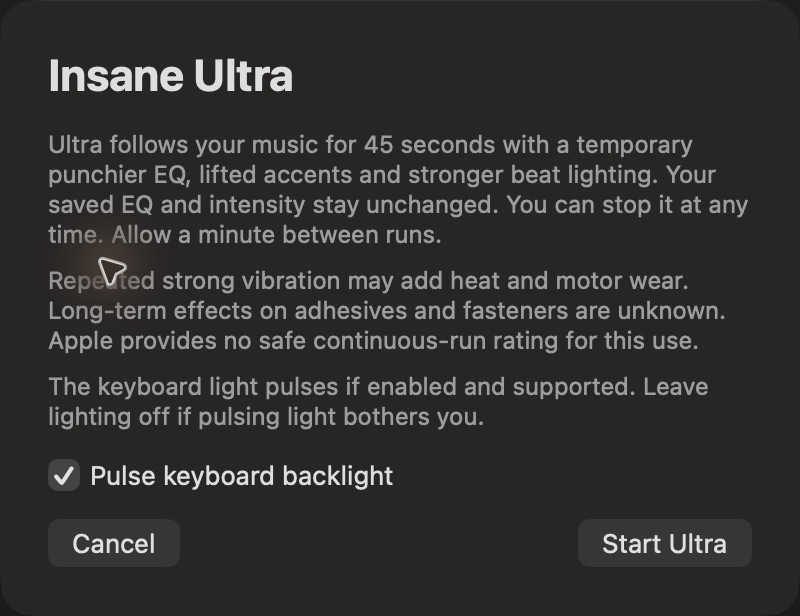

# Advanced controls audit

November 27, 2026. Scope: Trackpad EQ, Fine Tune, genre presets and Insane Ultra. Fresh captures use production Console views in a disposable native fixture at 810 × 640 player content size. Fake audio, permission and trackpad edges prevent recording, model inference and physical actuation. No actual listener preferences or system permissions were changed. The system's sharing/title-bar indicator is not app branding.

## 1. Main player — healthy, retain its grouping

Play/Stop, Output, Feel and Intensity are already visible, with optional links/files collapsed under Other sources and advanced controls behind Tools. There is no need to add more controls here. The active Stop Ultra action remains directly available during a run.

## 2. Existing tools — crowded, grouping too broad

One Tuning and effects heading combines a genre preset, Fine Tune, Ultra, lighting, volume following and a full EQ. Unrelated actions compete at the same level. Fine Tune and the experimental burst sit side by side; the EQ footer approaches the scroll boundary. Fine Tune itself presents a continuous list without Beat/Voice/Timing labels. The main-player separation works; the next level needs clearer chunks.

## 3. Sound — focused category, native navigation

Tools now offers three labeled categories: Sound, Trackpad EQ and Experiments. Only the selected content is exposed. Sound holds genre, existing conditional vocal controls, Follow Mac volume and Fine Tune. The category choice is local UI state; browsing does not apply a preset, change isolation or alter intensity. A fixed content area keeps category navigation and Done in place, with scrolling when needed. Changing category starts at its top.

This applies Hick's Law as a design heuristic: choose the kind of task first, then its relevant controls. It does not claim a measured improvement in decision time. Native radio-button semantics expose the category's selected state.

## 4. Trackpad EQ — self-contained and reachable

The existing EQ graph, enable switch, Bass/Mid/Treble controls, reset and Band Settings are together on their own page. The band-details screen retains three labeled band groups, now exposed as accessibility headings. A bounded scroll area prevents the sheet from depending on a tall display. The gain/frequency/Q bindings and ranges are unchanged.

## 5. Fine Tune — labeled chunks with applicable controls only

Beat, Voice and Timing headings divide the same existing controls. Beat has three values, Voice has three, and speaker-mode Timing has its toggle and offset. Both shows Beat and Voice; Trackpad only omits speaker timing as before. Reset and Done remain outside the scroll area. The Timing section can be reached in a compact window without losing the sheet's exit.

This uses Miller-style chunking to make related controls recognizable rather than invoking a fixed seven-item limit. Longer Both-mode content still scrolls; section headings help orientation, but spoken VoiceOver navigation and comprehension require listener testing.

## 6. Experiments and Ultra — separate, explicit confirmation retained

Keyboard light and Ultra live in Experiments. Local-file pattern controls appear here for a local source, under their own heading, retaining the existing output restrictions. Ultra's entry opens the existing notice and Start/Cancel actions. Opening or canceling it does not start playback. Its duration, cooldown, lighting default, temporary tuning override and safety text are unchanged.

## Validation and limits

Native UI checks cover category separation, scoped descriptions and explicit actions in light/dark and normal/reduced-motion states, heading order, preserved genre/EQ/intensity, band control reachability and canceling Ultra without activation. Fine Tune checks cover all six output/focus combinations, applicable sections, conditional quality controls, disabled volume-following in Trackpad only and scroll access to the last section. Fixture preferences are deterministic and audio/hardware edges fake. Genre selection is exercised through its native menu and retained across category changes. Advanced-sheet audits check descriptions within the owned content subtree; the app-wide action/parent-child passes cannot reliably isolate sheets and can return an unresolved element. Their existing setup/recovery coverage remains unchanged. Native interaction and heading-order checks supplement the advanced description audits without claiming full action/parent-child compliance. Existing setup/recovery, visual-listening, audio/DSP, update and iPhone compilation checks remain in CI.

The only production source changed is Console layout and accessibility metadata in SongWave.swift. No isolation, capture, DSP, haptic renderer, controller, preset value, new color or new animation is introduced. Screenshot evidence is static; it cannot establish spoken VoiceOver behavior, keyboard traversal under personal settings, speed, memory improvement, tactile clarity, comfort or hearing-accessibility benefit. These remain usability/listener validation tasks. [Accessibility coverage](../accessibility.md).
