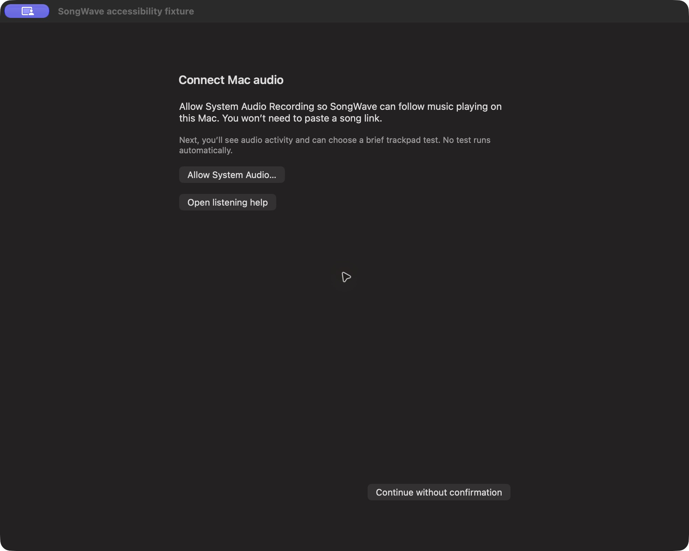
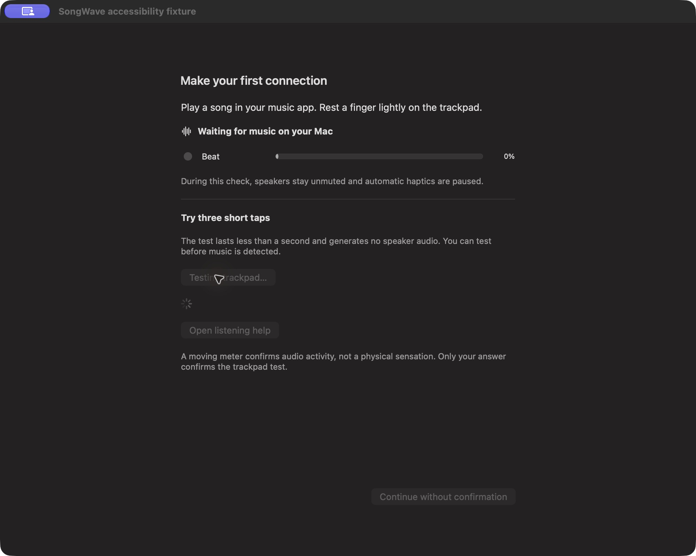
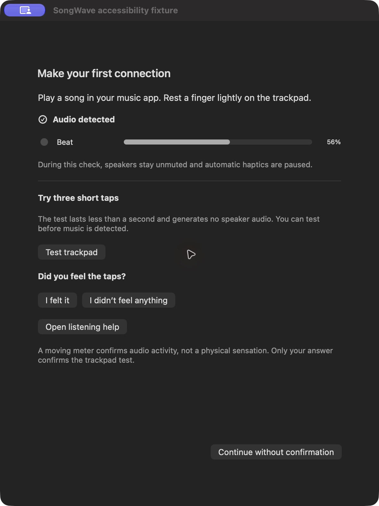
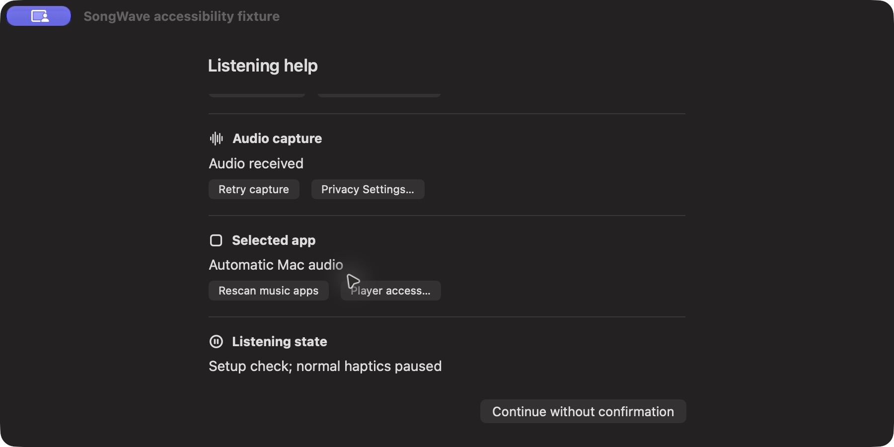
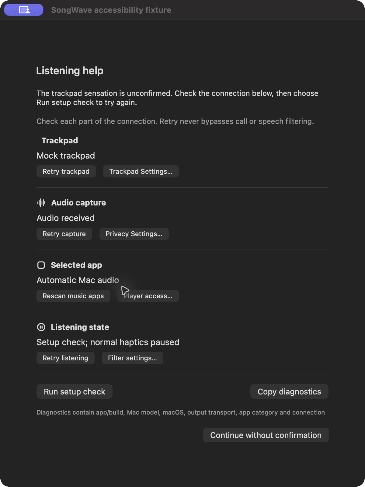
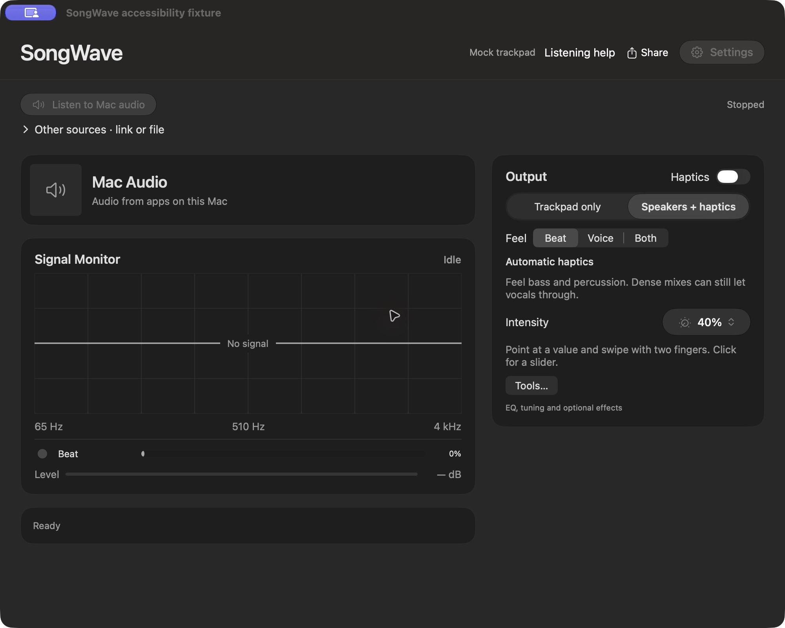
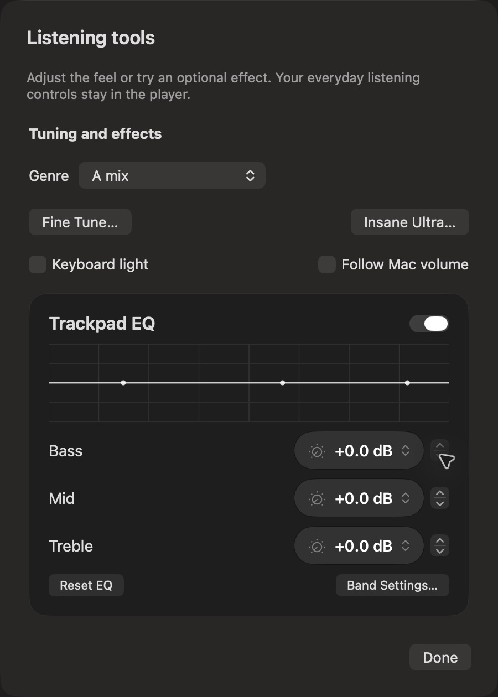

# First connection and recovery audit

November 27, 2026. Scope: roadmap items 2 and 3 after 0.5.10. The native monochrome design and isolation engine are retained.

These screenshots were captured and inspected during this audit from a disposable Mac fixture using the production views and controller, with simulated audio, permissions and trackpad hardware. The fixture's title bar and system screen-sharing indicator are not SongWave branding. No real permission was granted, song captured or motor sensation confirmed. Viewport sizes differ between the compact baseline and larger candidate fixture; they are flow evidence, not a pixel comparison.

## 1. Allow audio access — working

The existing setup explains why access is needed and offers an explicit Allow action. Permission success leads to audio detection and a Test trackpad action; it does not start a sensation test or imply that one was felt. New regression coverage checks that permission completion after closing the flow saves the authorization result without reopening setup or starting playback.

## 2. Detect audio, choose the test, confirm sensation — working with a status fix

The existing flow separates audio activity from a physical sensation, runs the short test only on request, and offers I felt it or I didn't feel anything after completion. Controls are disabled during the test. The fixture holds completion so the in-progress state can be inspected; the real sequence lasts less than a second.

The 0.5.10 detection label latched success even after audio stopped. The candidate distinguishes current audio from audio detected earlier. History remains available, but it no longer implies music is still arriving. Permission and audio activity never substitute for explicit tactile confirmation.

## 3. Recover in one place — fixed

The four existing sections cover trackpad availability, capture result, selected app and pause reason, each with a Retry and Settings action. Copy diagnostics uses categorical app/build, Mac/OS, output transport and connection/error state. Tests exercise the real controller formatter with private titles, artists, filenames, device names and raw errors; none are exported.

Two observed problems were fixed: entering recovery retained the setup scroll offset and could hide the trackpad section, and Retry capture jumped back into setup. Recovery now starts at the top; capture, app and listening retries stay in recovery. A setup retry uses unmuted capture with haptic output disabled. Only Run setup check returns to the sensation flow. Existing call/speech/video filtering remains enforced.

Code review also found that retrying a local file lost its position and manual haptics-off choice, a previous recording-permission failure could label a file's capture status as failed, and a successful trackpad retry cleared unrelated playback errors. The candidate preserves position/bypass, including when a live retry waits for permission, and keeps independent errors intact. Local files show that recording access is unnecessary; their capture retry is disabled and does not request permission. Retry labels match the selected source.

Observed baseline: recovery entered partway down the page

## 4. Return to everyday listening — grouping retained and covered

The normal player already prioritizes listening state, output, Feel and intensity. Optional links/files remain in Other sources. EQ, tuning, keyboard lighting and Ultra remain in Tools; local patterns are available there for eligible files. No additional everyday controls or color system were introduced. Native UI tests now protect this separation and the route into Tools.

## Verification and remaining evidence

Controller regressions cover in-place non-actuating retries, trackpad probe failure/recovery, permission denial and late completion, file restoration and bypass, accurate current-audio status, and privacy-safe diagnostics. The native suite covers permission → explicit test → confirmation, recovery actions, compact-window scroll reset, grouped player controls, labels/roles/reading order and light/dark reduced-motion states. [Commands and accessibility limits](../accessibility.md).

Screenshots and simulated tests do not verify motor motion, physical comfort, auditory/tactile sync, spoken VoiceOver navigation, keyboard traversal under individual settings, or a hearing-accessibility benefit. Physical testing with supported MacBooks and willing deaf and hard-of-hearing listeners remains necessary. OS permission prompts remain under macOS control. Developer ID signing/notarization is a separate unfinished roadmap item.
