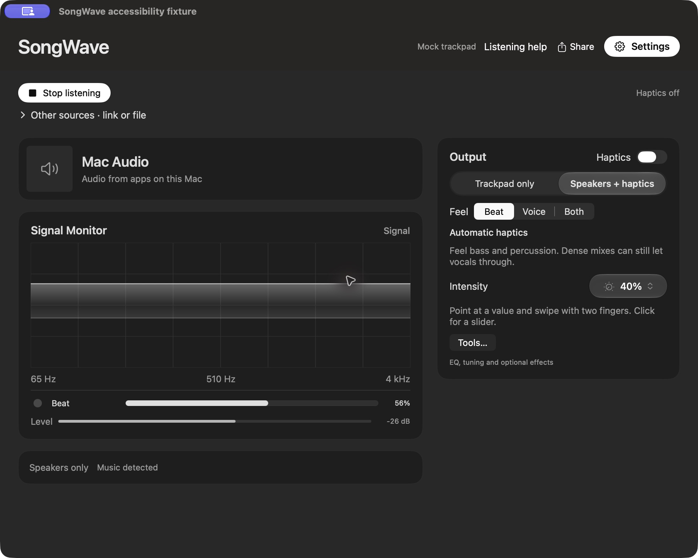
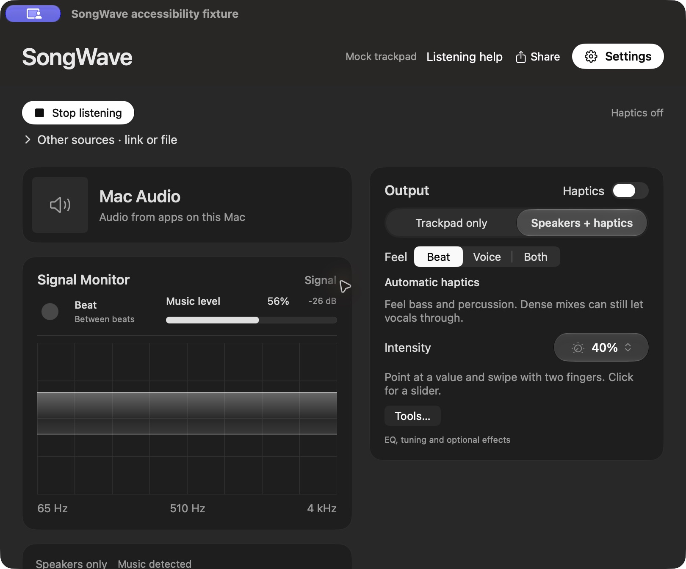
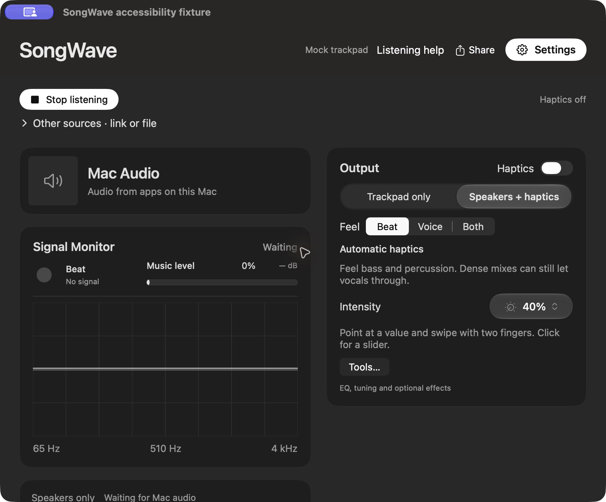

# Visual listening audit

November 27, 2026. Scope: beat and level feedback during ordinary listening, separate from setup/recovery. Production views were captured in a disposable native fixture with simulated signals and haptics off. No song was captured, motor actuated or system permission changed. The fixture title bar and system sharing indicator are not app branding. Different viewport sizes illustrate placement; these are flow captures, not a pixel-comparison study.

## 1. Existing main feedback — present, labeling unclear

0.5.11 already included a beat dot and level percentage below the main Signal Monitor's trace. A second Level bar repeated the same level with a dB reading. The first bar appeared beside the Beat label, making amplitude look like beat strength. It worked outside setup and with haptics off; adding another widget would duplicate feedback.

## 2. Ordinary listening — clarified in the same monitor

The main presentation now places two related items at the top of the Signal Monitor: a larger bounded Beat cue with Detected/Between beats text, and a labeled Music level bar retaining percentage and dB. The repeated bar is consolidated. The beat cue fades smoothly after detected events. It does not create a tempo estimate or additional beat events.

Placement keeps passive feedback separate from the Output/Intensity card and Stop action. For Fitts's-law concerns, existing action targets stay unoccluded; this display introduces no action target. For Miller-style grouping, rhythm and level form two labeled chunks inside one existing information area rather than another mode or panel. The beat's reserved frame prevents pulse size from moving controls. The cue precedes the technical trace so it stays visible in a compact window.

## 3. Silence and motion preferences — information retained

Silence clears the meter, shows No signal and removes any retained beat. Stop ends listening and clears visual activity. Reduce Motion fixes pulse size and brightness and removes interpolation while retaining beat text and level values. The indicator remains a single native progress-indicator accessibility element with an audio/level/beat description and no button action.

## Verification and limits

Pure presentation tests cover bounded pulse geometry/opacity, extreme and nonfinite levels, quiet/active/silent states, independent beat/level values, dB formatting and reduced motion. Existing visibility/expiry regressions protect hidden-window suspension and stale-beat cleanup. Native tests exercise listening with haptics off, music → silence → Stop, one passive progress role, minimum-window visibility and no overlap with Stop/Intensity, across light/dark and normal/reduced-motion states.

The isolation, capture, rhythm detector, motor renderer and controller are unchanged. The UI consumes the existing visual subscriber with its existing visibility-aware cadence; it adds no analyzer, audio lookahead or background polling service. Level is normalized analyzed-signal amplitude, not the manual Intensity setting. Focus, isolation, filtering and protected-source limitations still apply.

Static screenshots do not establish temporal legibility, synchronization, comfort or benefit for deaf/hard-of-hearing listeners. Those require willing listener feedback on supported hardware. Listening/capture and existing hardware requirements still apply even when haptics are disabled. No clinical or full accessibility-compliance claim is made. [Accessibility coverage and remaining checks](../accessibility.md).
